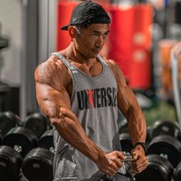
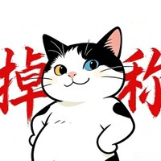
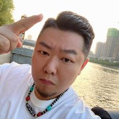
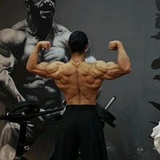

# 附 D　跟着谁看

先说清楚：**下面这六个人，都是我自己一直在看的。** 不是搜出来凑数的名单，是我手机里真的会点开、有的看了两年多。他们的内容对我很有启发——这本书里好几个判断，追根溯源是从他们那儿来的。

我得说清楚哪一部分是我的：方法归他们，落到我自己身上怎么用、哪些我试过哪些没试过，是我自己的账。

判断标准只有一条：他讲的东西最后能不能落回“吃进去的比花出去的少”。落不回去的，再大声也不听。

## B 站

**烧毁一切就是美**　平台：B 站　[主页直达](https://space.bilibili.com/1024129080)

在日本生活的中国上班族，我关注他的配料表、食品标签和训练内容。三大营养素怎么配、碳水怎么算、动作怎么做，讲得有秩序。他的价值在“为什么”——为什么要这么吃、为什么这么算。

对我影响最大的一点：他讲每一件事都先讲依据，再讲做法。我后来给这本书的每条结论标来源标签，源头在这里。

要注意：他是按健美备赛的标准讲的。你不打比赛，不需要那么严。

**心平气和的张老师**　平台：B 站　[主页直达](https://space.bilibili.com/356307984)

做健身科普。讲训练原理、增肌计划、停训之后肌肉会不会掉，一句一句说，不喊口号。他的价值在“原理”——动作为什么这么做，计划为什么这么排。

想练力量又怕被“一周速成”带偏的人，适合看他。第四部分那六个自重动作的要点，有不少是照他讲的原理写的。

**宝克力气大**　平台：B 站　[主页直达](https://space.bilibili.com/44052063)

大基数的真实记录。从三百二十斤开始减，现在两百八十斤上下，视频里天天讲吃了什么、掉了多少、怎么撑住的。他的价值在“过程”——你能看到一个三百斤的人一个月大概掉多少，中间会遇上什么。

他让我明白一件事：大基数减重最难的不是方法，是“今天还要不要继续”这件事本身。他的签名写着“别网暴我，我有肥胖症”——这句话我记了很久。

要注意：这是个人记录，不是方法课。他做对的你能学，他的节奏不一定适合你。

## 抖音

抖音的个人主页链接要挂一串账号内部编号，我给不了可核的直链，所以下面尽量写**抖音号**——在 App 里搜号最准，比搜名字靠谱，同名的太多。宁哥有礼这个号我没拿到确切的抖音号，你就搜名字，认头像。

**宁哥有礼**　平台：抖音

减脂博主，风格暴躁，讲供能、平台期、皮质醇，成体系，也有成套的课在卖。

**谭成义**　平台：抖音

网上也常写成“谭成毅”，人称谭师。他的减脂计划做得细，按性别、按每周有效运动时长分档，给出碳水、蛋白质、脂肪各多少克。要照着用，去看他原视频里的完整计划和适用条件。

适合已经练起来、想把吃法算精确的人。零基础先别钻这个，容易算晕。

**张司**　平台：抖音。

做健身科普，栏目叫“减脂的暴躁小课堂”，说话冲，讲原理也讲心态。他有一句话我认同，也写进了这本书：减肥不是考研，不用把每一样都算到小数点。

## 怎么用这份名单

**一，看原理的跟看记录的分开。** 张老师、烧毁一切就是美属于前者——他们讲为什么，能迁移到你自己的条件上。宝克力气大属于后者——他给你参照系，让你知道一个真在减的人是什么样。两类都看，但别拿记录当方法。

**二，留意利益关系，但逐条看证据。** 卖课或带货可能影响内容选择，应当披露；它本身不能证明观点对错。别只看有没有 A 标签，还要看研究质量、适用人群和具体结论。

**三，冲突的说法不要急着选边。** 先确认双方原话、时间尺度和能量口径是否相同，再看各自依据。

**四，一个人只看一个方向就够了。** 减重这件事的知识量不大，看五六个人、看二十个人，能拿到的还是那些。真正改变的是你每天记不记、走不走、吃多少。名单长不如动作稳。

## 我没推荐的

卖代餐、卖酵素、卖“七天瘦十斤”课的一律不在这份名单里。不是因为他们的方法一定无效，而是这类账号的内容和商品绑得太紧，不好分离。

还有一个提醒：不要照着某个博主的饮食清单买一周的菜。他们的方案是按自己的体重、训练量、生活节奏配的，你直接照抄，最可能的结果是吃不下。

---

头像取自他们各自平台的公开头像，只作识别用，不作任何背书。主页、账号名和内容都可能变化，使用时以平台现状为准。

