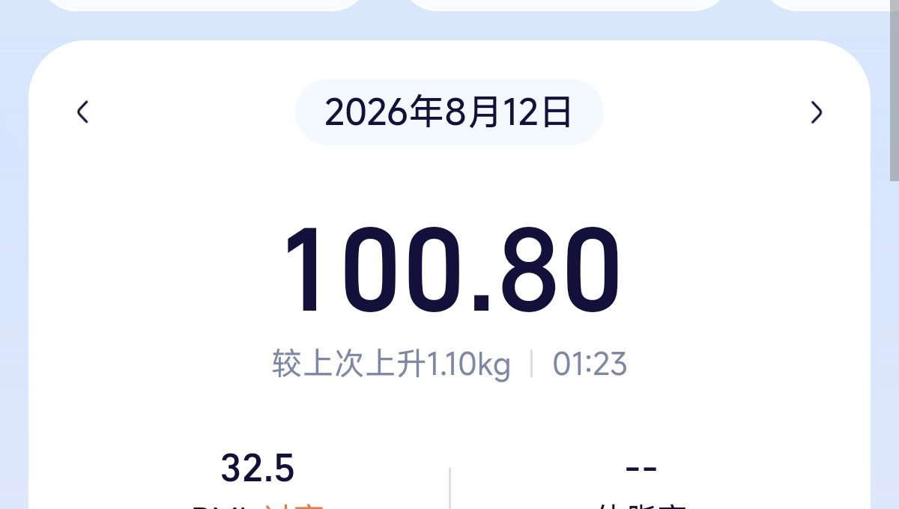
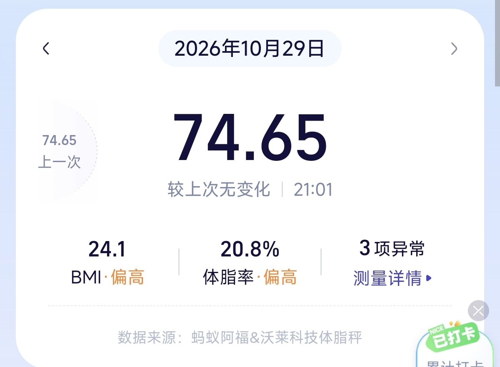

# 第零部分　我的账

先交代三件事：我真的瘦过、这套东西哪里不好用、我的数字经得起看。

## 0.1　两张截图

一张是 8 月 12 日凌晨 1 点 23 分，100.80 公斤，BMI 32.5，体脂率那栏是空的，没测出来。

一张是 10 月 29 日晚上 9 点 1 分，74.65 公斤，BMI 24.1，体脂率 20.8%。

同一台秤，同一间屋，中间隔了 78 天。

口径先说清：一次是凌晨睡醒，一次是晚上吃完饭，身体里差着一两公斤的水和食物。所以这两张图看的是量级，不是克数。你要拿它当什么证据都行，就是别当精密仪器读数。

还有一句得提前说：**100.80 这个起点不是天上掉的**。

我 19 岁之前，基本都是胖的。19 岁那年下过一次狠手，三个多月掉了 80 斤，从 188 斤到 108 斤。

后来是慢慢回来的。疫情两年多的时候开始长，但长的不多；2022 年之后才真的一路胖起来，回到 200 斤上下。

所以这不是我第一次减肥，是第二次。这本书里写的那些坑，有几个我踩过两遍。

你从 65 公斤开始，没有 26 公斤可以减，那是好事，不是这本书对你没用。

## 0.2　78 天 26.15 公斤，这速度我不推荐

算一遍：100.80 减 74.65，26.15 公斤，78 天，平均一周 2.35 公斤。

《成人肥胖食养指南（2024 年版）》写的是：比较理想的目标是 6 个月内减掉当前体重的 5% 到 10%，合理速度是每月 2 到 4 公斤；刚开始减，建议先定一个每周约 0.5 公斤的小目标。原文明确写着“减重速度并非越快越好”〔G1，A〕。

我一周 2.35 公斤，是每月 4 公斤那个上限的两倍多。

19 岁那次比这还狠：三个多月 80 斤，折下来一周五六斤。当时没觉得有什么，年轻、扛得住。账是几年后结的：那 80 斤没守住，疫情两年多开始往上走，2022 年之后一路回到 200 斤上下，前后好几年。

这次一周 2.35 公斤，比当年慢了一些，也就慢了两成上下。跟指南比，我照样是超的。这不是谦虚，是我栽过。

为什么指南要把速度压下来？指南原话是：过快的减重“易对机体器官组织造成损伤”；短期快速掉的主要是水，不是脂肪，一恢复正常吃饭就弹回来〔G1，A〕。《肥胖症诊疗指南》另外提醒减重时要盯着肌少症，还写了体重快速下降是胆结石的高风险因素（这句是在减重手术那一节里说的）〔G9，A〕。我自己还担心两样：身体开始省钱，也就是代谢适应；头发一把一把掉〔C〕。

这几样我一样都没测。没测不等于没发生，只能说我这 78 天运气好，没进医院。上一句是实话，不是免责声明。

所以这本书给你的目标不是“78 天 26 公斤”，是**起步一周 0.5 公斤左右，一个月 2 到 4 公斤**。我的速度是我自己的账，不是给你的标准。

## 0.3　我做了什么，没做什么

做了的：

先是游泳。膝盖撑不住跑，就先下水，掉了 10 斤左右，从 200 斤上下到 190 斤。

然后转跑步，配上每天 15000 步左右的总活动量。

再就是记录，每一口都记，包括随手抓的那一把。

没做的，得一条条摆出来：

力量训练一次都没系统练过。所以第四部分给你的抗阻方案，是我按自己的缺口补的，不是我练出来的心得。

没遇到平台期。这不是本事，是我还没走到那一步，两个月的时间不够长。

维持期没走完。我下秤的那天就是这本书的终点，体重会不会回来，我还没有数据。

拍照估热量到现在都不准。我能说的只是“比不拍强”，说不到“拍得准”。

所以第六部分（卡住了怎么办）、第七部分（瘦下来之后）、第八部分（安全边界）不是我的战果，是照指南和论文写的，每一处都标了来源，你可以直接去核。

我的账只到“我瘦下来了”这一格。

---

下一部分开始拆网上的说法。十一条，一条条过。
