# 第四部分　怎么练

这一部分比前面短，因为练这件事，能做的其实不多，做对了就够。

## 4.1　什么算大基数

先把标准摆出来，别凭感觉。

按中国的成人体重判定标准：BMI 24 到 27.9 算超重，28 及以上算肥胖〔G8，A〕。腰围男性 ≥90 厘米、女性 ≥85 厘米，算中心型肥胖。

举个数：1.75 米的人，超重线是 73.5 公斤，肥胖线是 85.75 公斤。

腰围怎么量：站直，放松，别收腹。位置按国家标准来——身体侧面最下面那根肋骨的下缘，和胯骨（髂嵴）最高点，取两点的中间高度，水平绕一圈，呼气末读〔G8，A〕。同一个位置、同一个时间量，才有比较的意义。

但“大基数”这个词，我想给它换个说法。它真正问的不是你多重，是你的**关节和心肺现在扛不扛得住跑跳**。

所以 BMI 和腰围能提示风险，但不是判断能不能跑的唯一门槛。体重明显偏高、长期没动或关节不舒服的人，先选能耐受的走路、水中活动等，再根据症状、功能和既往训练经历进阶；有基础病的先评估。

## 4.2　大基数：先吃后练

我自己的顺序：先游泳，掉了 10 斤左右，然后才转跑步。

为什么不一上来就跑？膝盖。

体重、肌肉力量和跑量都可能影响膝盖能不能适应。尤其是很久没动过的人，先从能舒服完成的活动起步，别急着追跑量。

**起步分三档，对号入座。**

**第一档**，BMI ≥28，或者很久没动过：走。每天 20 到 30 分钟，分成两段也行。有条件就下水游泳，水里膝关节的负担比陆地上小得多。每周 3 到 5 次。

**第二档**，走路和基础动作已经能稳定完成，没有关节不适：走路照旧，加入适合自己的自重抗阻，每周 2 次，从 4.4 的 A 套 15 分钟版起步。有氧时长逐步增加。这是功能进阶，不是 BMI 到某一条线才能开始抗阻。

**第三档**，已经能轻松完成较长时间步行、没有关节不适，且健康评估允许：可以尝试走跑交替，比如跑 1 分钟、走 2 分钟，按耐受重复，8 次只是示例。不追配速，先适应；每周加多少看症状和恢复，10% 只是经验法则，不能保证防伤。

**不管哪一档，这几样一出现就停：** 胸口疼或发紧、喘不上气（不是累得喘，是憋）、心慌心跳乱、头晕眼前发黑。停下歇几分钟还不缓过来，去医院。有心脏病、血压没控制住、在吃降压药或降糖药的，开始动之前先问一句医生。

运动要循序渐进，诊疗指南也是这个原则〔G9，A〕。

**再说一天的活动量。**

指南给的量是：中低强度有氧为主、抗阻为辅，有氧每周 150 到 300 分钟，每周 5 到 7 天，至少隔天一次；抗阻每周 2 到 3 天，每次 10 到 20 分钟；每周通过运动消耗 2000 千卡以上〔G1，A〕。

这个量不小，是要往上够的目标。别指望第一周就做到，你现在一周只走三次，先走到五次，就是进步。

还有一条容易忽略的：每天静坐和被动看屏幕的时间控制在 2 到 4 小时以内，长期伏案的人每小时起来活动 3 到 5 分钟〔G1，A〕。这一条不花你任何意志力，收益比一次硬撑的训练大。

**开始动的头一周可以这么排**（按第一档写；第二档在周三、周六各加一次 A 套 15 分钟版）。跟着第五部分 30 天走的人，这是第 3 周的事，前两周先记录、设缺口：

- 周一：走 30 分钟
- 周二：休
- 周三：走 30 分钟
- 周四：休
- 周五：走 30 分钟
- 周六：游泳或快走 40 分钟
- 周日：休，但别躺一天，出门走两趟

一周动四次，加起来两个小时出头，离指南的每周 150 分钟还差一截。先把习惯建起来，再一周一周往上加。

## 4.3　减重时，别只做有氧

保住肌肉，不能只靠一种运动。热量缺口过大、蛋白质没吃够、缺少抗阻训练、恢复不足，都可能增加肌肉流失。

指南在这件事上说得很清楚：减重过程中不能只看体重，要看体脂率和肌肉量的变化，目标是减少肌肉流失、维持肌肉量和基础代谢率〔G1，A〕。它给的手段就是抗阻运动每周 2 到 3 天。

我说句自己的：我 78 天里，抗阻一次都没系统练过。所以我掉的那 26.15 公斤里有多少是肌肉，我没有数据。这不是谦虚，这是我这本书的缺口，第四部分就是为了补它才写的。

## 4.4　抗阻最小方案

三套，每套 6 个动作，每周 2 到 3 次，隔天做。先选适合自己能力的版本；动作拿不准、有疼痛或既往伤病的，找合格专业人员帮助评估。

**A 套：自重，家里一块垫子就够**

深蹲、俯卧撑（推墙起步，进阶到跪姿）、臀桥、弓步、平板支撑、提踵。

每个动作 2 组，8 到 12 次；平板支撑 20 到 40 秒。组和组之间歇 60 到 90 秒。

**A 套 15 分钟版**：只做深蹲、俯卧撑、臀桥三个，各 2 组；时间还有富余，再加一组平板支撑。刚起步、第 3 周开始练的，就从这个版本做。

下面每个动作配一张分解图，左格是起始，右格是做到位。照片来自 Free Exercise DB（公有领域），我按起止两帧拼在一起，标上了要点。

这几个动作，先把姿势做对，再谈组数。姿势错了，练的是伤。

**深蹲**

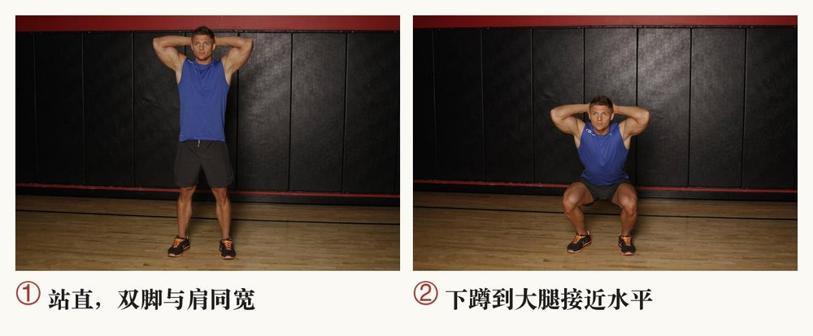

膝盖跟着脚尖方向，别往里扣；重心在脚掌中后段。起步就用椅子：站起来、坐下，不许用手撑。

**俯卧撑（两个版本）**

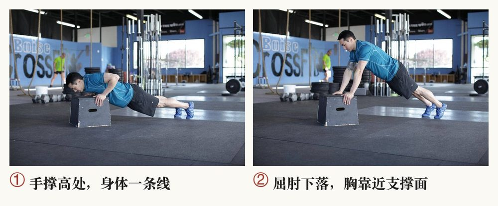

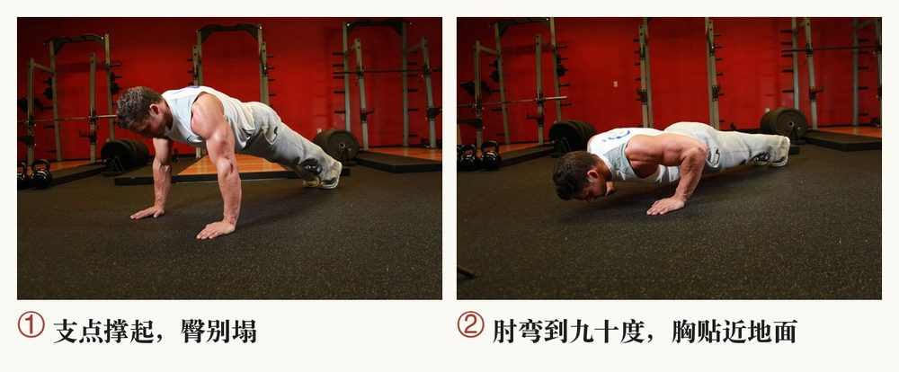

身体成一条线，臀别塌。推墙或手撑桌子是上斜版，撑得越高越省力；能做到十个标准俯卧撑再往上加难度。

**臀桥**

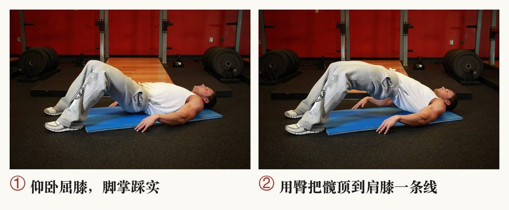

用屁股发力，不是用腰挺起来。顶到髋、肩、膝一条线就停，别往上翻腰。

**弓步**

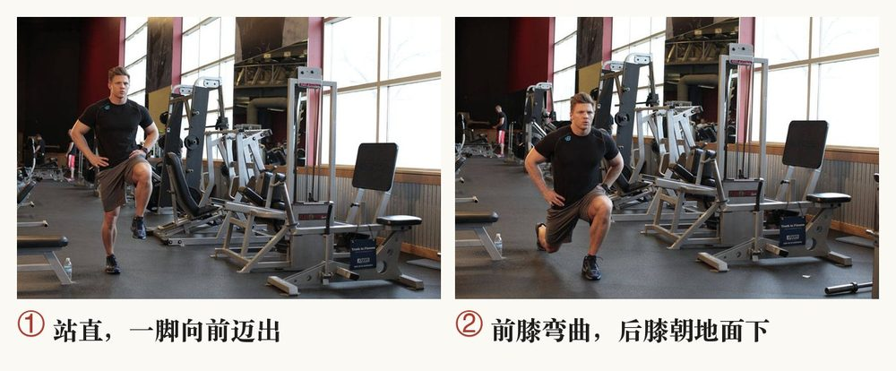

前膝不超过脚尖太多，后膝垂直往地面去。站不稳就扶墙，别硬撑。

**平板支撑**

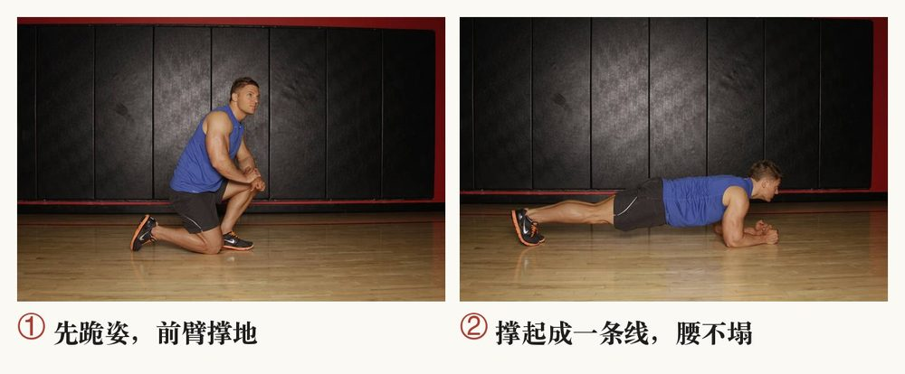

腰别塌，宁可缩短时间，也别撑着塌腰。撑不住就跪姿，跪着撑一分钟比塌腰撑三十秒强。

**提踵**

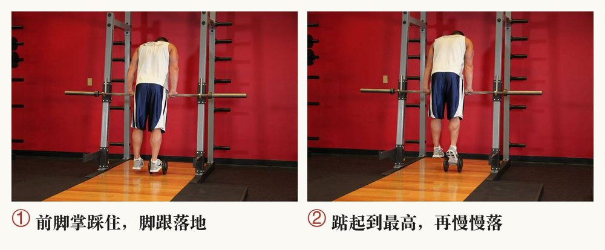

慢慢落，落下去那两秒才是关键。踮到最高停一下再放。

**B 套：哑铃或壶铃，重量按每个动作分别选**

不统一规定每只几公斤。从能控制全程的轻重量起步，最后一两次略费力但动作不变形；肩推和深蹲可能需要不同重量。

高脚杯深蹲、单臂划船、哑铃卧推、罗马尼亚硬拉、肩上推、负重走。每个 3 组，8 到 12 次。

**高脚杯深蹲**

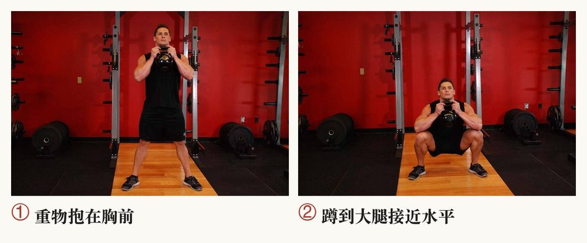

重物抱在胸前，蹲的时候胸别往前扑，膝跟着脚尖方向。

**单臂划船**

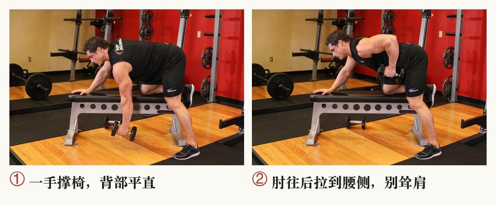

一手撑椅子，背保持平直；肘往后拉到腰侧，别耸肩、别甩身体。这个动作伤了肩，要养很久。

**哑铃卧推**

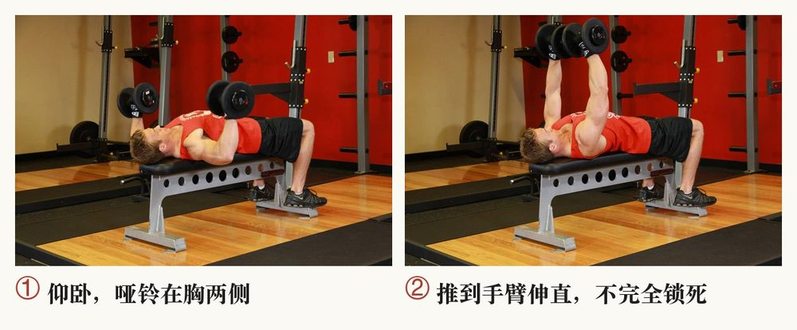

下到胸两侧，推到手臂伸直但不锁死。没有凳子的，躺在地板上做，肘碰到地面就起。

**罗马尼亚硬拉**

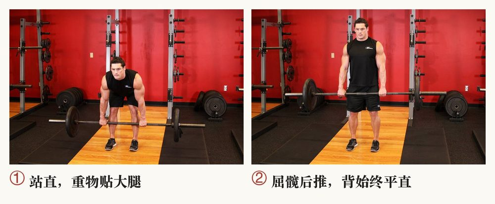

靠屈髋把重物沿大腿往下放，背始终平直，感觉大腿后侧拉开就起身。别追着让重物触地——重量一大、背一圆，腰就先出事〔C〕。

**肩上推**

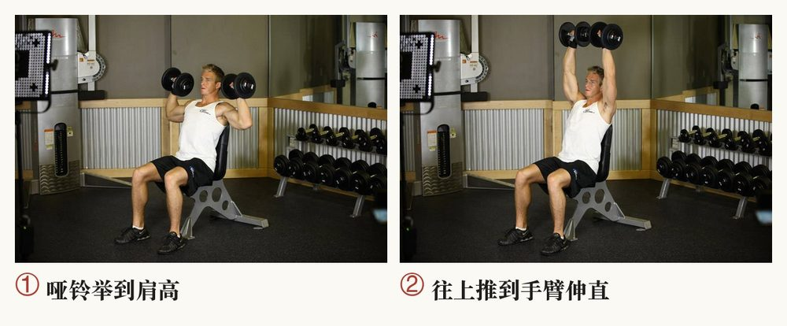

从肩高往上推，别用腰后仰借力。坐着做能逼掉一部分借力。

**负重走**

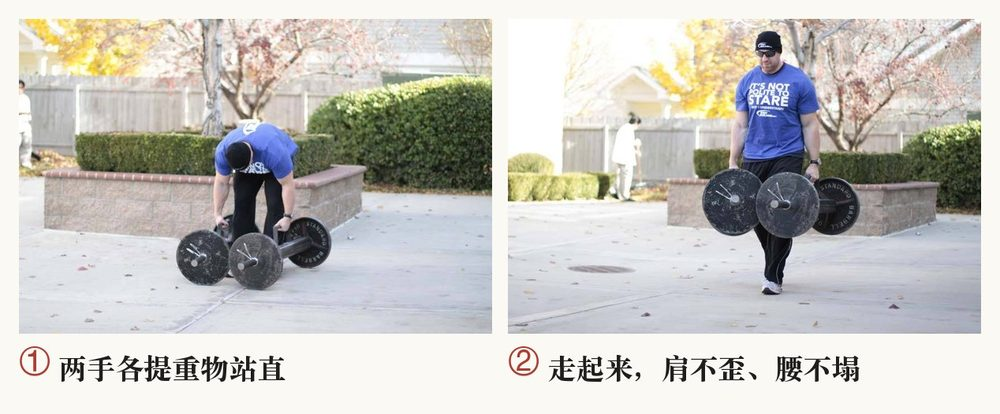

两手各提一个重物，站直往前走，肩不歪、腰不塌。走 30 到 60 秒算一组，这个动作练的是核心和握力，比看上去累。

**C 套：健身房器械**

腿举、高位下拉、坐姿划船、胸推、腿弯举、卷腹。每个 3 组，10 到 12 次。

器械的好处是轨迹固定，不容易做错；坏处是重量加得太快，人容易只推得动前半程。

**腿举**

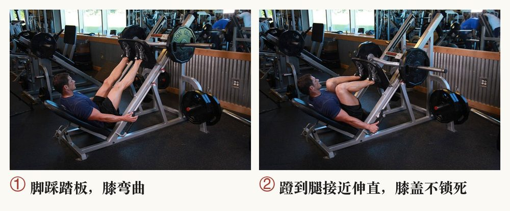

脚踩踏板与肩同宽，下到大腿接近胸口，蹬起时膝盖别锁死。

**高位下拉**

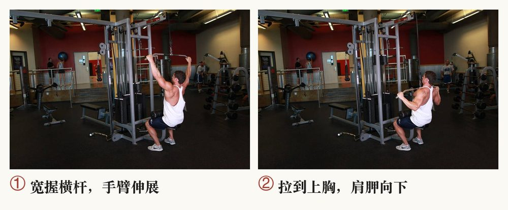

宽握，先让肩胛往下沉，再拉到上胸。别靠身体后仰去拽。

**坐姿划船**

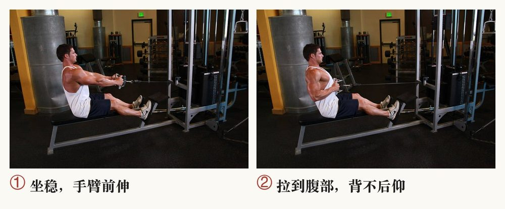

坐稳，先收肩胛再拉，拉到腹部，别用腰往后仰。

**胸推（器械）**

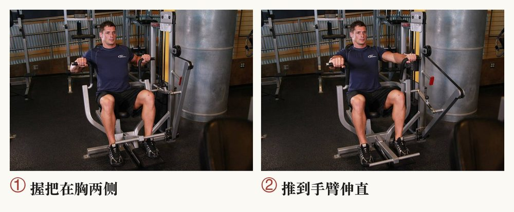

握把在胸两侧，推到手臂伸直，肩别耸。

**腿弯举**

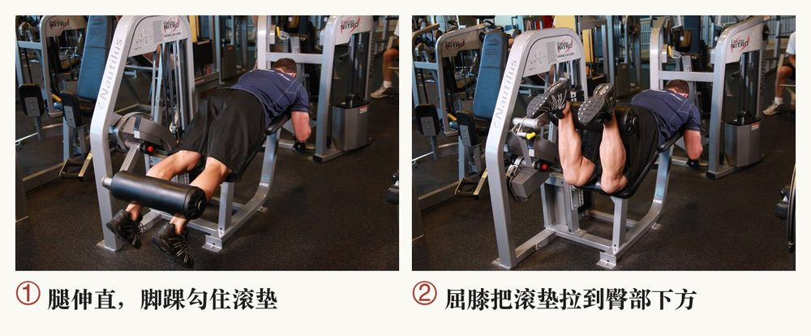

慢慢屈膝把滚垫拉过来，放回去的那两三秒才是重点。

**卷腹**

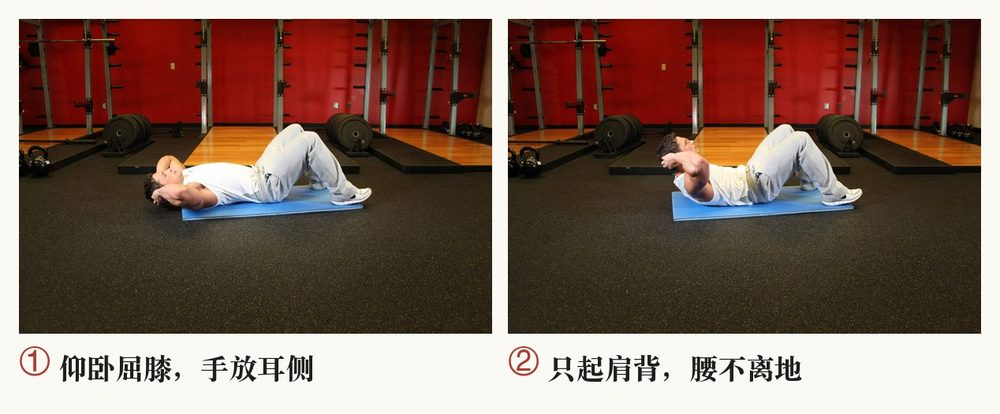

只起肩背，腰不离地。别用手拉脖子——手一拉，脖子先吃力，这是练卷腹最常见的伤法〔C〕。

**30 分钟版**：热身 5 分钟，六个动作按顺序做 3 轮（每轮之间歇 60 到 90 秒），最后拉伸 5 分钟。

**C 套 15 分钟版**：只做三个动作——腿举（蹲）、胸推（推）、坐姿划船（拉），每个 3 组。时间不够的时候，做这三个比不做强太多。

**三条原则：**

重量选到最后一两次有点吃力、但动作不变形。变形的重量不算数。

组间歇够，别赶，60 到 90 秒。你要的是刺激，不是心率。

什么时候加量：某个动作两组都能做满 12 次、动作不变形，下一周就加一点——自重的换难一级的版本（推墙→跪姿→标准俯卧撑），哑铃和器械加一档重量，或者每个动作多做一组。一次只加一样。

关节疼就停，肌肉酸可以继续。这条分不清的人最容易受伤。胸闷、心慌、头晕，按 4.2 那条，马上停。

## 4.5　小基数

BMI 24 以下、腰围正常的人，重点该从“减重”换成“改体型”。

做法：抗阻每周 3 次，有氧 2 次。2.8 说过，BMI 和腰围都正常的人不用减重；腰围偏大、想收一收的，缺口开小一点，300 左右，参考量和适用情况看 2.3。

这个阶段最常见的情况是体重不动，裤腰在动。别急着看秤，看照片和腰围。

## 4.6　有氧怎么选，还有那些零碎的动

**关节负担从低到高排**：游泳、椭圆机 → 骑车 → 快走 → 慢跑 → 跳绳和高强度间歇。

按你现在的体重选，不是按别人的推荐选。80 公斤的人和 55 公斤的人，能承受的不是一回事。

膳食指南的原话是“主动身体活动最好每天 6000 步”〔G2，A〕，说的是专门出去走的那部分，不算屋里来回挪的。减重期全天总步数到 8000 到 12000 更好，这是我的建议〔C〕。走路这件事的好处是它不占时间——通勤、打电话、饭后十分钟，都能算进去。

**爬楼有个诀窍**：上去爬，下来坐电梯。上楼的负荷是往上推，下楼是刹车，膝盖最怕的是刹车〔C〕。

**别小看零碎的动**：站着打电话、饭后走十分钟、地铁早下一站。把步行穿插进通勤、家务和休息时间，可以减少另外安排训练的负担，但仍然需要时间和体力。

练这件事，最值钱的不是强度，是不停。

## 4.7　跑步到底怎么跑

跑步的技术，吵了几十年。能落到地上的其实就三条：步频别太低，落脚别伸到身体前面，量别加太快。剩下的那些——前脚掌还是后脚跟、胳膊摆多少度、要不要上碳板鞋——要么证据不硬，要么跟减重没关系。

**先说步频。**

步频是一分钟落多少步。新手跑起来常常 150 到 160，专业选手常在 180 上下，于是“180”这个数就被传成了标准。它不是标准。

有研究让跑者把步频提高 5% 到 10%：膝盖的负荷两档都降；髋关节的负荷只在提高 10% 时才明显降下来，提 5% 时没看到变化〔R15，B〕。注意被支持的那句话是“比你现在的步频快一点”，不是“必须跑到 180”。

怎么用：数你现在三十秒落多少步，乘二，再往上加一成。150 的加到 165 左右就够，别一步跳到 180，改了步频又改姿势，身体同时适应两件事，最容易伤。

**再说落脚。**

跑步圈吵得最凶的是前脚掌还是后脚跟落地。有一项系统综述把五十三项研究收在一起看：改成前脚掌落地，膝盖的屈曲幅度和髌股关节的应力确实低了，但负荷挪到了踝关节和小腿的跖屈肌上；跑步经济性没有改善的证据；至于受伤风险，现有研究几乎都是回顾性的，缺前瞻性证据，关系定不下来。作者的结论很干脆：对一个没受伤的、习惯后脚跟落地的人，不建议改〔R16，A〕。

所以不用刻意改，也别信“改了姿势就能跑更快”这种话。但有一件事值得改——落脚点别伸得太靠前。下面这条不是那篇综述的结论，是教练圈通用的经验〔C〕。

脚落在骨盆底下那一下，膝盖是弯的，冲击由肌肉吸收；脚伸出去老远再落地，膝盖几乎是直的，冲击直接传给关节。这个区别在慢动作里看得一清二楚。

自查：让家人拿手机从侧面拍你跑十秒，慢放，看落地点在骨盆前面还是骨盆底下。在前面一大截的，就是步幅太大，先收小。

**量怎么加。**

“每周加量不超过 10%”这句话你肯定听过。它没有研究证明 10% 是那个神奇数字，属于经验法则〔C〕。“突然翻倍”更是很多人受伤的那一下，膝盖、胫骨、跟腱都挨这一刀〔C〕。

我的做法更保守：连续两周跑完都舒服，第三周才加。加完那周有点酸是正常的，疼到走路不舒服，就退回去。

大体重的人，先走跑交替：跑一分钟，走两分钟，重复八次。把总时长当目标，配速先别看。等这套能连着做四十分钟不难受，再谈纯跑。食养指南给的方向本来就是有氧为主、抗阻为辅〔G1，A〕。

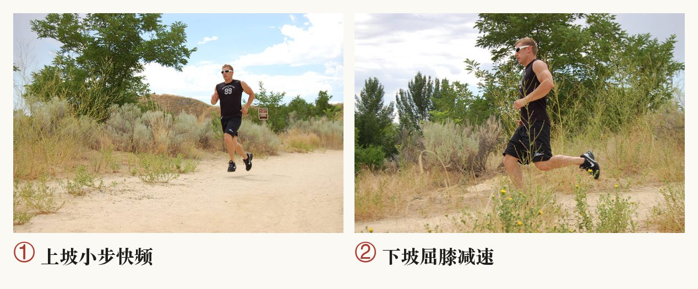

## 4.8　二区心率：先跑得轻松

刚开始跑步，先用一个简单办法判断强度：**试着说一整句话。能舒适说完，就先保持；说到一半要频繁换气，就慢一点。**

说话测试能辅助判断运动强度〔R20，B〕，不需要设备。不过，它不能精确告诉你正处于手表的哪个分区。有胸闷、心慌、头晕等不适，按 4.2 停下来处理，别只看心率。

**手表上的二区怎么看。**

跑圈常说的“二区”，多指五区体系里最大心率的 60% 到 70%，大致是轻松有氧那一档。耐力研究还有三区体系，同样叫“二区”，指的强度却不同〔R17，A〕。本书说二区，取前一种意思。

想估个数，可以用“208－0.7×年龄”估算最大心率〔R18，B〕。四十岁算出来是 180，取 60% 到 70%，就是每分钟 108 到 126 次。最大心率是估的，个人可能有明显差异，手表读数也会受佩戴和测量影响；这个区间先作参考。

**为什么你在指南里看到的是另一个数。**

《肥胖症诊疗指南》用的是心率储备算法〔G9，A〕：

> 靶心率＝[(220－年龄)－静态心率]×(60%～80%)＋静态心率

同样四十岁，如果静态心率是 70，算出来是 136 到 158。它和手表二区的算法、强度范围不同，不能直接替换。刚开始动、体重较大的人，先把能舒适完成的活动练稳定，再考虑增加强度〔C〕。需要精细制定运动方案时，可以找医生评估，有条件再做心肺运动试验〔G9，A〕。

网上还常讲“八成低强度、两成高强度”。这是耐力训练的一种安排，不是减重初学者必须完成的比例。先把轻松运动坚持下来，不必为了凑两成，专门把自己练到喘不过气。

## 4.9　呼吸：能说的和不能说的

网上有很多“三吸两呼”“两吸一呼”的口诀，说得像有讲究。我去找了研究。人和步频耦合这件事，1983 年就有人在跑者身上实测到过〔R30，B〕；但专门比较“固定呼吸节律”和“自然呼吸”哪个更好的研究，我没找到像样的。没有一个数字是从研究里长出来的。

所以这一节我只说三件事。

第一，别数呼吸。呼吸跟着强度走，是身体自己调的。你刻意数，注意力反而从姿势和路面上挪开了。

第二，鼻子吸、嘴呼，或者全程用嘴，都行。天冷、空气干的时候用鼻子吸舒服一点，这是体感，不是研究结论〔C〕。

第三，把呼吸当仪表，别当任务。跑起来能不能说完一整句话——这就是你的强度表，比任何口诀都准〔R20，B〕。喘到说不出话，降下来；一路轻松，可以再加一点。

至于跑步时侧腹疼，常见说法是“呼吸节奏错了”。这个说法我没找到过硬证据。2015 年一篇综述把各种解释过了一遍：膈肌缺血这条被认为不太可能，内脏韧带牵拉也解释不了全部现象；能确认的诱因主要是刚吃完就跑、喝太浓的饮料，最能解释症状的是壁腹膜受了刺激〔C〕。实操就一句：饭后至少等两小时再跑，跑前别灌甜饮料。

## 4.10　再补几个动作

4.4 那三套是骨架，够你把大肌群练起来。这一节补八个更细的，都能在家做，不用器械。

**死虫**——练核心稳定，重点是腰不塌。仰卧，双手朝上，双腿抬起屈髋屈膝各九十度，对侧的手和腿慢慢伸直再收回，腰始终贴地。

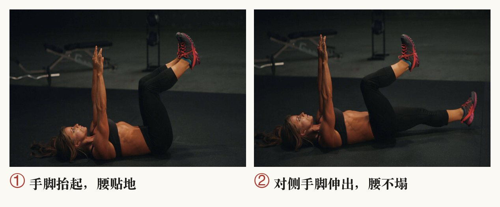

**侧平板**——侧腰和髋外侧。肘撑地，身体成一条线，髋别往下掉。撑不住就把下面的膝盖跪地。

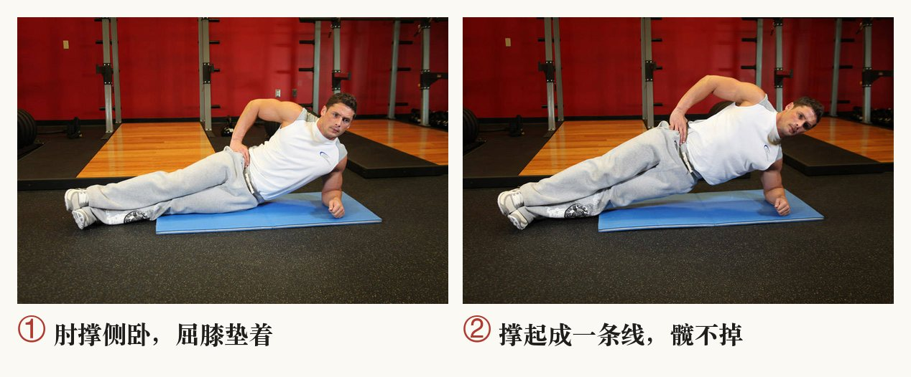

**俯卧背伸**——背部和腰。趴着，手腿同时抬离地面一点点，停两秒，慢慢放下。别抬到腰疼，这不是比谁抬得高。

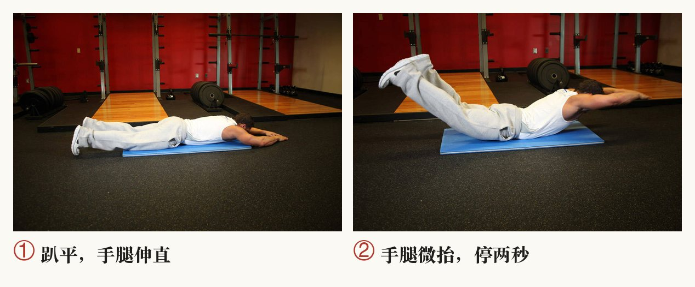

**登台阶**——大体重的人可以用它代替弓步，台阶低一点的时候膝盖压力比弓步小〔C〕。先选低而稳的台阶，整只脚放稳，主要靠台上的支撑腿发力站起，再慢慢下来。不要把地面后脚猛蹬当成主要发力，也不按“接近膝盖高”统一选高度；疼痛或站不稳就降低难度。

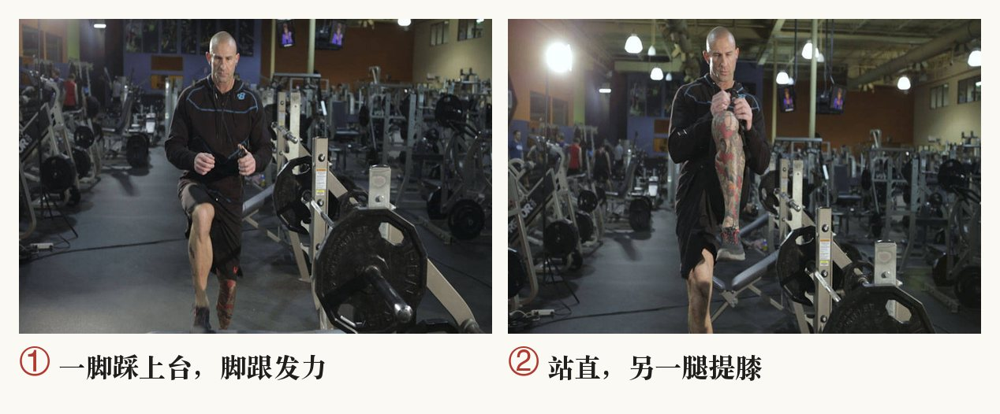

**单腿臀桥**——臀桥的进阶。一条腿伸直抬起，另一条腿的脚跟踩地顶髋。腰别代偿，顶到肩、髋、膝一条线就停。

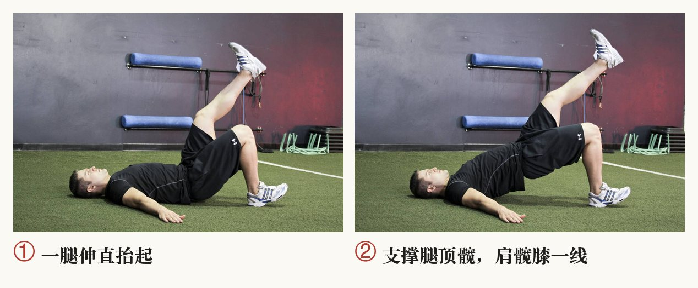

**登山跑**——有氧加核心，心率上得快。撑地，两腿交替往胸口提。BMI 高的时候先别做，手腕和腰吃不消。

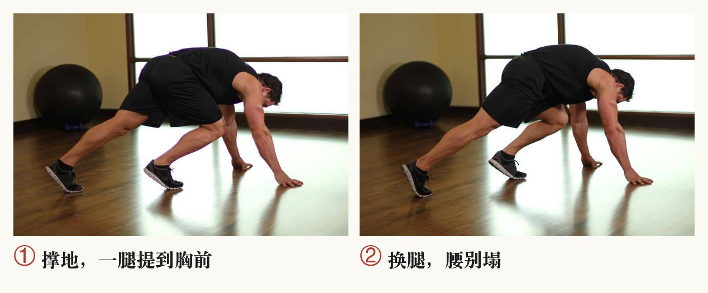

**快走和坡度走**——最被低估的一项。跑步机坡度调到 5% 到 10%，速度放慢一点，心率一样上去，膝盖的负担比跑小得多。走的时候别死抓扶手，那是把体重卸给机器了。

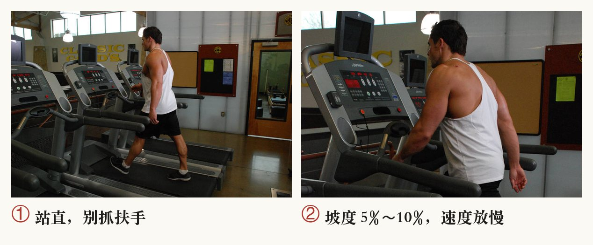

**跑后拉伸**——小腿和髋前侧。跑完趁身体热着做，每个动作三十秒，慢慢呼，别弹震。

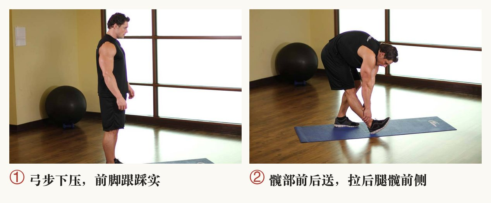

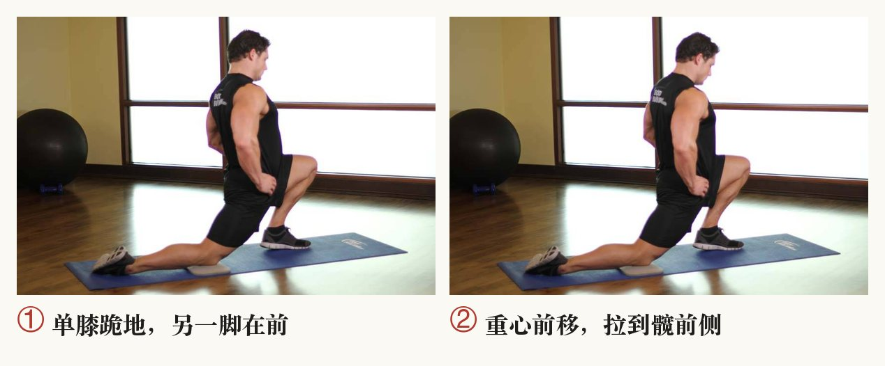

这些动作的照片都来自 Free Exercise DB，公有领域，可以随便用〔S2〕。全书 40 张动作图里，4.4 和 4.10 这两节加起来 28 张，4.7 那张跑步示意图 1 张。我把每个动作的起止两帧拼成一张，标了要点；动作本身没改，也不是我本人示范。

## 4.11　运动性价比排行：从夯到拉

哪项运动最值，这事儿能吵一晚上，因为“值”这个字没定义。我先说清楚我按什么排。

四条：花多少钱、占多少时间、学不学得会、赔不赔身体。再补一条我自己的：明天还愿不愿意做。

消耗怎么算：MET 值乘以体重（公斤）、再乘以小时数，约等于这小时烧掉的千卡〔G19，A〕。MET 是什么？坐着不动是 1，活动强度是它的几倍。70 公斤的人动一小时，大概烧 MET × 70 千卡。这是我拿计算器算出来的，不是在你身上测的，个体和实际训练方式都会影响结果，当精确数看会失望。这里算的是活动期间总消耗，包含本来就有的静息消耗；有组间休息的力量训练，也不能按整整一小时持续用力来算。别把表里整块热量当成额外缺口。

这张表的 MET 值有两个来源，我分开说清楚：《成人肥胖食养指南》附录 6 收了《健康成年人身体活动能量消耗参考值》（T/CSSS 002—2023）的一张表〔G19，A〕，快走、慢跑、骑行、跳绳、健身操这些它都有，我优先用它；游泳、爬楼梯、抗阻训练、弹力带、器械这几项国标表里没有，用的是国际通用的身体活动能量消耗 Compendium〔R21，A〕。两套体系不完全对得上，所以下面的数只能当量级看。

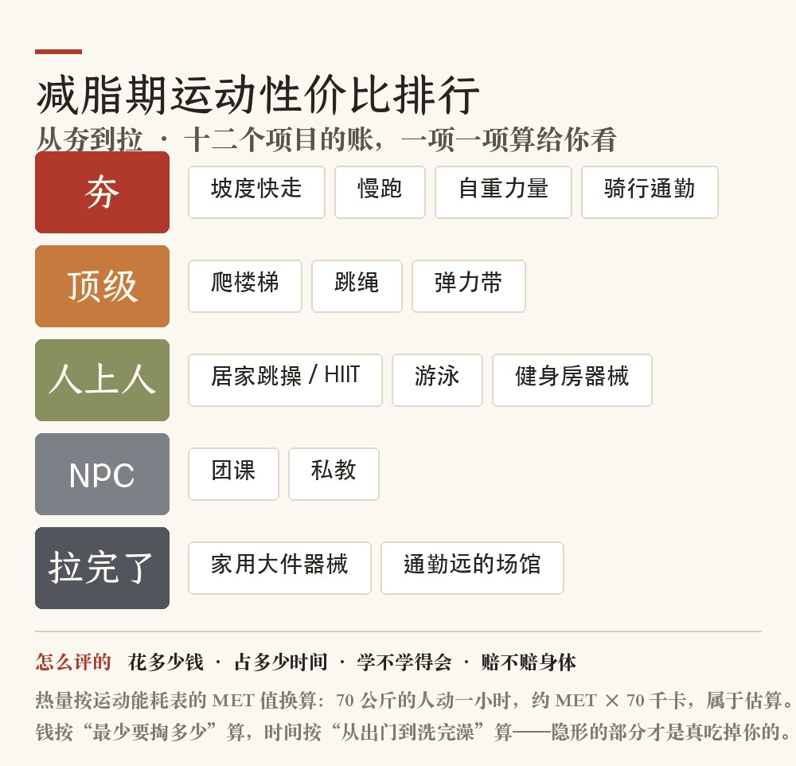

然后是价格的口径：表里的钱和时间只是作者举例，未作市场价格调查，不代表各地现价。钱按“开始这项运动最少要掏多少”算，不按“最贵能花多少”算。时间按“从出门到洗完澡”算，不按“手环上那 40 分钟”算——隐形的部分才是真正吃掉你的部分。

| 项目 | 起步要花的钱 | 实际占的时间 | 门槛 | 70 公斤一小时 | 隐性成本 | 档位 |
| --- | --- | --- | --- | --- | --- | --- |
| 坡度快走 | 0 | 40–60 分钟 | 不用学 | 370–560 千卡 | 耗时长，得凑够时间 | 夯 |
| 慢跑 | 一双鞋 | 40–60 分钟 | 低，但关节要适应 | 570–640 千卡 | 跑量加太快会伤 | 夯 |
| 自重力量 | 0 | 20–30 分钟 | 要学动作 | 250–350 千卡 | 热量不高，收益在保肌肉 | 夯 |
| 骑行通勤 | 骑行费或购车装备费 | 取决于路程及原交通方式 | 会骑车 | 270–390 千卡 | 安全问题 | 夯 |
| 爬楼梯 | 0 | 10–20 分钟 | 不用学 | 慢走 280，快步 620 | 下楼冲膝盖 | 顶级 |
| 跳绳 | 20 元一根绳 | 15–25 分钟 | 中等，要协调 | 约 710–860 千卡 | 冲击大，体重大先别跳 | 顶级 |
| 弹力带 | 50–100 元 | 20–30 分钟 | 要学几个动作 | 250–350 千卡 | 阻力有限，练到后面不够用 | 顶级 |
| 居家跳操、HIIT | 0 | 20–30 分钟 | 低 | 跳操约 510，HIIT 更高 | 动作不标准伤膝腰 | 人上人 |
| 游泳 | 30–60 元一次 | 90 分钟起 | 要会游 | 410–690 千卡 | 场地加通勤加洗澡 | 人上人 |
| 健身房器械 | 1500–3000 一年 | 90 分钟起 | 低 | 250–420 千卡 | 来回通勤是隐性税 | 人上人 |
| 团课、私教 | 200–500 一次 | 90 分钟起 | 低 | 350–510 千卡 | 钱花在“有人盯”上 | NPC |
| 家用大件器械 | 3000–10000 | 看你在不在家 | 低 | 跟户外一样 | 占地，最大风险是吃灰 | 拉完了 |
| 远距离场馆项目 | 场地费 | 单程半小时起 | 中 | 看项目 | 45 分钟的运动变成两小时行程 | 拉完了 |

### 夯：好到没什么可挑的

**坡度快走**是我心里的第一。没有跑步机，就找一段缓坡、小区里的坡道，或者走楼梯上去；有跑步机，坡度调到 5% 到 10%，速度降下来，心率一样上去，膝盖负担比跑小得多。户外一分钱不花，不用学，能打电话、能听书；家里有跑步机的，下雨也能做。不用凑满四十分钟才开始算数。从能完成的时长起步，分段累计也有意义〔G21，A〕。

**慢跑**的单位时间回报比快走高，70 公斤的人按 8 到 9 公里/小时跑一小时，五百七到六百四十千卡。所谓“后燃”是指运动结束后消耗还高一会儿，量不大，别当额外奖励〔C〕。代价写在明面上：前四周是关节适应期，跑量增长超过自身适应能力时，膝盖和小腿可能出现不适；一成不是保证安全或必然受伤的分界线。它夯，但不是新手第一天就该冲的项目。

**自重力量**热量不高，按一千卡算账它排不进前三。但它决定你减下来是“瘦”还是“瘦得塌”。减重期掉的体重里有一部分是肌肉，指南要求减重时减少肌肉流失，运动上给的就是“有氧为主、抗阻为辅”〔G1，A〕。零成本、家里两平米就够，这一项不算性价比，算地基。

**骑行通勤**可以把通勤和运动合在一起，但新增时间取决于路程和原本交通方式，不一定为零。共享单车通常仍需付费；自己的车还涉及装备和维护。通勤速度大概 12 到 15 公里/小时，一小时三百千卡上下，别按环法比赛算。路况、安全和个人便利，决定它对你划不划算。

### 顶级：多花一点，但账还算得过来

**爬楼梯**：快步上楼的能耗是平地快走的两倍上下〔R21，A〕，十分钟抵二十分钟，一分钱不花。慢速上楼的单位时间消耗较低，但照样算身体活动，不能说“不算”。唯一要记的是上楼练、下楼坐电梯——下楼是膝盖在刹车，体重大、膝盖本来就不舒服的人，这一段能省就省〔C〕。

**跳绳**效率最高，这张表里它一小时耗得最多，一根绳二十块。但它同时要协调、要场地、要能承受落地冲击，体重大的人前四到六周别碰，先走路。

**弹力带**是家里最划算的一件器材。五十到一百块一根，抽屉里就能收，臀桥、划船、侧平举、深蹲都能加阻力。它排不到夯，是因为阻力有上限，练到半年以后你会觉得不够用；在那之前，它能把自重训练的天花板往下推很久。

### 人上人：花钱办事，用上了才算值

**居家跳操和 HIIT** 的好处是快，二十分钟结束战斗；坏处是“累”和“有效”不是一回事。跟着视频乱蹦，动作一散，膝和腰先出问题。

**游泳**对关节最友好，体重再大也不压膝盖，一小时 410 到 690 千卡。但它的真实成本不是票价，是场地、通勤、洗澡加起来一个半小时起——同样的时间，快走能走两趟。

**健身房器械**买到的其实不是器械，是齐全、氛围和可加重量。年卡一千五到三千，不贵；贵的是每天来回那四十分钟。住得远的人，这笔税比年卡贵。

### NPC：不坏，但也没多好

**团课**。一群人一起练，有音乐有人喊，气氛确实能推你多动十分钟。但你交的钱里有一大半买的是气氛，动作对不对，教练一个人看不过来七八个人。

**私教**不是没用。对一个完全不知道怎么开始的人，“有人盯着、有人纠动作”值这个钱，前面几节课能把深蹲、硬拉这些基本动作教会你。但对已经能自己练的人，你花的是溢价——买的是准时到场，不是方法。同一个动作练三个月之后，你需要的是加重量，不是再交十节课的钱。

### 拉完了：钱和时间都花在过程上

**家用大件**：跑步机、椭圆机，机器本身和健身房那台没区别，跑起来消耗也一样。它的成本结构是“钱一次性花完、地方一直占着、用不用全看你”。我没查过家用器械的闲置率，不编数；你只要想想身边买过跑步机的朋友，心里就有数了。

**通勤远的场馆项目**最冤：运动四十五分钟，路上来回一小时，洗澡二十分钟。你不是没时间运动，是把时间花在了路上。

**还有一个坑**：先买装备再开始。鞋、表、衣服、补剂，一口气买齐，人反而被这些准备工作拖住了。真要买，等这件事你已经做了四周再买。

### 一句话的排序原则

今天下楼就能做、明天还愿意做的，夯。

得开车、得预约、得先买个大件、得等一个天气才能开始的，拉完了。

中间那三档，网络上的叫法是顶级、人上人、NPC；说的其实就是“多花点钱、多欠点条件，值不值”这一件事。

最贵的从来不是私教和年卡，是买完不用。

这张表是我按上面那四个口径自己排的，不是学术结论。你要把“社交”算进性价比，团课和球场的名次会往前挪好几位；你要是只有晚上十点以后有时间，健身房反而成了唯一选项。口径变了，排名就会变，这话我认。

---

下一部分给一个能直接照着做的东西：30 天。
